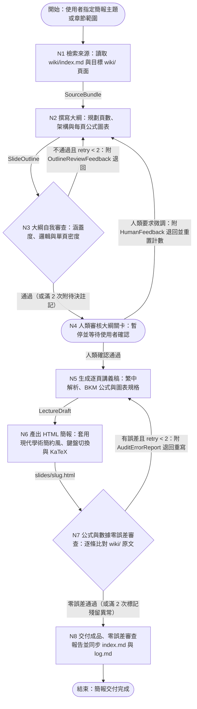

# AGENTS.md — 《投資學》LLM Wiki 最高工作憲法

> 本檔案為本專案之唯一最高規範（Schema）。任何 LLM Agent 在新對話視窗中接手本專案時，**必須先完整閱讀本檔案**，並嚴格遵守所有架構、命名、公式、連結與作業流程規範。

---

## 1. 專案定位與核心哲學

- **專案名稱**：《投資學》個人增量知識庫（Investments LLM Wiki）
- **對應課程與教材**：大學修課《投資學》，教科書為 **Zvi Bodie, Alex Kane, Alan J. Marcus — *Essentials of Investments***（以下簡稱 **BKM**）。
- **核心設計理念（Andrej Karpathy LLM Wiki Pattern）**：
  - 不做一次性問答 RAG，而是持續編譯、增量維護一套結構化、高度雙向連結的 Markdown 知識庫。
  - **分工原則**：人類負責提供原始資料（手機 OCR 文字檔、個人筆記）、審核更新提案、提出探索問題；**LLM 全權負責維護 `wiki/`**——包括公式還原、知識拆解、跨頁雙向連結、模型演進串聯、目錄與日誌更新，以及未來基於 `wiki/` 產出圖文講義型 HTML 簡報。

### 新對話啟動必讀清單（Session Bootstrap）
每當開啟新對話視窗並開始任務前，Agent **必須依序讀取**：
1. `agents.md`（本檔，確認最高規範）
2. `wiki/index.md`（掌握目前已收錄的所有章節、模型、概念、比較頁與待核對項目）
3. `wiki/log.md` 尾端最新 5–10 筆紀錄（掌握近期進度與脈絡）

---

## 2. 目錄架構與存取權限

```text
investment_wiki/
├── agents.md               # [Schema] 本專案最高工作憲法（人機共同演進）
├── .gitignore              # Git 忽略規則
├── raw/                    # [Layer 1: 原始層] 絕對唯讀（Immutable Source of Truth）
│   └── chXX/               # 建議依章節分資料夾存放 OCR .txt/.md 與個人筆記
├── wiki/                   # [Layer 2: 知識層] LLM 全權維護的 Markdown 知識庫
│   ├── index.md            # 全站內容目錄、章節進度與待核對清單
│   ├── log.md              # 時間軸操作日誌（Append-Only，嚴禁覆寫歷史）
│   ├── chapters/           # 各章節脈絡總覽與重點地圖
│   ├── models/             # 財務模型與定價理論頁（強調假設、公式、限制與演進鏈）
│   ├── concepts/           # 核心概念、金融工具、風險與績效指標頁
│   └── comparisons/        # 跨章節比較、綜合分析與高品質問答沉澱頁
├── slides/                 # [Output] 未來自動產出的圖文講義型 HTML 簡報
└── assets/                 # [Assets] 視覺圖表、座標圖（SVG / PNG）與附圖
```

### 權限鐵律
1. **`raw/` 絕對唯讀**：原始 OCR 檔或個人筆記一旦歸檔至 `raw/`，**嚴禁任何修改、覆寫或刪除**。所有公式修復、排版整理與知識重構皆只寫入 `wiki/`。
2. **`wiki/` 由 LLM 主導維護**：每次更新皆須保持跨頁一致性，不可留下斷鏈或未同步的 `wiki/index.md`。
3. **`slides/` 以 `wiki/` 為單一事實來源**：簡報應直接彙整已校對的 `wiki/` 內容，不直接從未整理之 `raw/` 硬轉。

---

## 3. 檔案命名與雙向連結規範

### 3.1 檔案命名規則（嚴格英文 `kebab-case`）
所有檔案名稱一律使用 **小寫英文、數字與連字號 `-`**（禁止空格、底線與中文檔名），兼顧 Git 跨平台相容性與 Obsidian 圖譜管理：

| 目錄 | 命名規則 | 範例 |
| :--- | :--- | :--- |
| `wiki/chapters/` | `chXX-<english-slug>.md`（兩位數補零） | `ch07-capm-and-apt.md` |
| `wiki/models/` | `<model-slug>.md`（優先採業界標準簡稱或完整學名） | `capm.md`, `apt.md`, `markowitz-portfolio-theory.md`, `black-scholes.md` |
| `wiki/concepts/` | `<concept-slug>.md` | `sharpe-ratio.md`, `duration.md`, `systematic-risk.md` |
| `wiki/comparisons/` | `<a-vs-b>.md` 或 `<synthesis-slug>.md` | `capm-vs-apt.md`, `cml-vs-sml.md` |
| `raw/` | `raw/chXX/chXX-<source-type>.<ext>` | `raw/ch07/ch07-ocr-summary.md`, `raw/ch07/ch07-notes.txt` |
| `slides/` | `chXX-<slug>.html` 或 `<topic-slug>.html` | `ch07-capm-and-apt.html`, `bond-pricing-guide.html` |
| `assets/` | `chXX-<desc>.<svg\|png>` 或 `<slug>.<svg\|png>` | `ch07-sml-diagram.svg`, `efficient-frontier.png` |

> **全庫檔名唯一性原則（Global Filename Uniqueness）**：由於採用 Obsidian `[[wikilink]]` 短連結，`wiki/` 底下所有子資料夾（`chapters/`、`models/`、`concepts/`、`comparisons/`）的 `.md` 檔名**必須全域唯一**，嚴禁跨資料夾同名。

### 3.2 雙向連結語法（Obsidian Wikilink）
- 站內連結一律採用 Obsidian 雙向連結附顯示別名格式：`[[檔名不含副檔名|中文或中英顯示名稱]]`
  - 正確範例：`[[capm|資本資產定價模型 (CAPM)]]`、`[[sharpe-ratio|夏普比率 (Sharpe Ratio)]]`、`[[ch07-capm-and-apt|Ch.07 CAPM 與 APT]]`
  - 若連結特定標題可使用：`[[capm#模型假設與限制|CAPM 的核心限制]]`
- **禁止**在 `wiki/` 內部使用相對路徑 Markdown 連結（如 `../models/capm.md`），統一採用 `[[slug|label]]` 以確保 Obsidian Graph View 與反向連結面板運作正常。
- **雙向回填義務（Evolution Backfilling）**：當新匯入的章節出現修正、延伸或挑戰既有模型的理論時（例如 `[[apt|套利定價理論 (APT)]]` 或多因子模型放寬了 `[[capm|CAPM]]` 的單因子與市場組合不可觀測限制），**必須同步回頭編輯舊模型頁面**，在「模型演進與關聯」區塊補上指向新模型的連結。

---

## 4. 頁面格式規範（彈性精簡模板）

本知識庫採 **「核心強制、其餘彈性」** 原則：**只強制規範 YAML Frontmatter、標準 LaTeX 公式區塊與模型演進連結**；其餘段落依該章節或概念的知識特性自然撰寫，絕不為了填滿模板而硬湊空洞文字。

### 4.1 強制規範 1：YAML Frontmatter（所有 `wiki/` 頁面必備）
每份 `wiki/` 頁面開頭必須包含以下標準 Frontmatter（供 Obsidian Dataview 與未來 HTML 簡報自動化腳本讀取）：

```yaml
---
title: 資本資產定價模型 (CAPM)
en_title: Capital Asset Pricing Model (CAPM)
type: model            # 限填：chapter | model | concept | comparison
chapters:
  - ch07               # 關聯章節代碼列表（如 ch06, ch07）
tags:
  - asset-pricing
  - equilibrium-model
status: active         # 限填：draft | active | needs-review
sources:
  - raw/ch07/ch07-ocr-summary.md
updated: 2026-11-21    # YYYY-MM-DD
---
```

### 4.2 強制規範 2：標準 LaTeX 公式與符號定義
凡涉及數學定義、定價公式或風險計算的頁面，必須使用獨立公式區塊 `$$ ... $$`（嚴格相容 KaTeX），並緊接在公式下方條列或表格說明所有符號的經濟意義（遵循第 5 節 BKM 標準符號）。

### 4.3 強制規範 3：模型演進與關聯（`type: model` 頁面必備）
所有財務模型頁（`wiki/models/*.md`）必須包含清楚的模型假設、限制與演進連結區塊：
- **核心假設（Key Assumptions）**：條列模型成立的前提條件。
- **模型缺陷與限制（Limitations & Critiques）**：指出實務或理論上的弱點（例如假設過強、實證檢定爭議、邊界條件失效等）。
- **模型演進鏈（Model Evolution）**：
  - **理論前身 / 基礎**：例如 `[[markowitz-portfolio-theory|馬可維茲現代投資組合理論]]`
  - **後續修正 / 延伸模型**：例如 `[[apt|套利定價理論 (APT)]]`、`[[fama-french-three-factor|Fama-French 三因子模型]]`（若對應章節尚未匯入，仍可先寫明模型名稱並註記「待後續章節建立」，日後匯入該章節時補齊為雙向連結）。

### 4.4 四類頁面的建議彈性結構參考

- **`chapters/`（章節頁）**：Frontmatter → 本章核心問題與學習地圖 → 重點觀念與公式摘要 → 本章拆解之模型與概念連結（`[[...]]`）→ 跨章節脈絡銜接。
- **`models/`（模型頁）**：Frontmatter → 核心直覺 → 核心假設 → 標準 LaTeX 公式與符號表（強制）→ 實務應用／圖形直覺（選用，可用 Mermaid 或預留圖表說明）→ 模型缺陷與限制（強制）→ 模型演進鏈（強制）。
- **`concepts/`（概念頁）**：Frontmatter → 核心定義 → 標準 LaTeX 公式與符號表（若有公式則強制）→ 直覺解讀／比較與延伸連結（`[[...]]`）。
- **`comparisons/`（比較與綜合頁）**：Frontmatter → 比較背景 → 核心維度對照表（Markdown Table）→ 公式與條件差異 → 實務選用指南／考題判別要點 → 關聯頁面連結。

---

## 5. 語言風格、BKM 標準符號與 KaTeX 規範

### 5.1 語言與術語規範
- **撰寫語言**：繁體中文，採用台灣大學財務金融／投資學慣用術語（例如：投資組合、無風險利率、超額報酬、系統性風險、非系統性風險、效率前緣、資本配置線、存續期間、凸性、夏普比率、詹森阿法）。
- **專有名詞首次出現中英並列**：每個頁面中，財務專有名詞首次出現時必須採「中文 (English Term)」格式，例如「夏普比率 (Sharpe Ratio)」、「證券市場線 (Security Market Line, SML)」；同頁後續行文可直接使用中文或英文縮寫。

### 5.2 BKM (*Essentials of Investments*) 標準符號對照表
撰寫或修復公式時，**一律優先對齊 BKM 原書符號慣例**（若該章節或題目有特殊定義，須於符號表顯式註明）：

| 類別 | 標準符號 | 意義 |
| :--- | :--- | :--- |
| **報酬率** | $r$, $E(r)$, $r_f$, $r_M$ | 實現報酬率、預期報酬率、無風險利率、市場投資組合報酬率 |
| **超額報酬** | $R_i = r_i - r_f$ | 資產 $i$ 之超額報酬（Excess Return），市場超額報酬為 $R_M = r_M - r_f$ |
| **風險與共變** | $\sigma^2$, $\sigma$, $\text{Cov}(r_i, r_j)$, $\rho_{ij}$ | 變異數、標準差、共變異數、相關係數 |
| **配置與效用** | $w_i$, $y$, $A$, $U$ | 資產權重、風險資產配置比例（債券章節中 $y$ 亦表 YTM，須依語境說明）、風險趨避係數、效用分數 $U = E(r) - \frac{1}{2}A\sigma^2$ |
| **指標與定價** | $\beta_i$, $\alpha_i$, $e_i$, $S_p$ | 系統性風險 Beta、詹森阿法 Alpha、公司特有殘差項、夏普比率 |
| **固定收益** | $P$, $C$, $T$, $D$, $D^*$ | 債券價格、每期票息、到期期間、馬考萊存續期間 (Macaulay Duration)、修正存續期間 (Modified Duration) |
| **權益與衍生品** | $D_1$, $g$, $k$, $S_0$, $X$ | 下期股利、股利成長率、要求報酬率、標的現貨價格、選擇權履約價（BKM 慣用 $X$，可附註亦常見 $K$） |

### 5.3 KaTeX 與未來 HTML 簡報相容規範
為了讓 `wiki/` 內容在 Obsidian 與未來 `slides/` 的 HTML 簡報中皆可零修改直接渲染：
- 行內數學用 `$...$`，獨立置中公式用 `$$...$$`。
- **嚴格使用 KaTeX 原生支援語法**（如 `\frac{}{}`, `\sqrt{}`, `\sum_{i=1}^{n}`, `\text{}`, `\begin{aligned}...\end{aligned}`），禁止使用 KaTeX 不支援的自訂巨集（`\newcommand`）或冷門套件語法。
- 內文提及真實貨幣金額時請避免與數學定界符衝突，請寫 `USD 100`、`NT\$1,000` 或 `\$100`（絕不在同段落留下兩個未跳脫的 `$`）。
- 概念流程圖、模型演進圖優先使用標準 **Mermaid**（`flowchart LR` / `flowchart TD`），並在節點文字含括號時加上雙引號（例如 `A["CAPM (單因子)"]`）；若需精確座標圖，日後可存於 `assets/` 並以標準圖片語法引用。

---

## 6. OCR 公式修復與透明標記機制

由於原始資料來自實體書手機拍照 OCR，常出現希臘字母誤判、上下標掉落、分數線斷裂或括號缺失（例如 `E(r;) = rf + Bi[E(rM) - rf]`、`o2`、`Cov(rD, rE)`）：
1. **保持 `raw/` 原貌**：絕不更動 `raw/` 檔案。
2. **自動偵測與還原**：於撰寫 `wiki/` 時，對照 BKM 投資學理論與標準符號，主動將所有破損數學表達式還原為正確、標準的 KaTeX 公式。
3. **不確定處透明標記（強制）**：若 OCR 文本嚴重殘缺、缺漏條件、正負號模糊，或存在多種可能解釋而無法 100% 確定時：
   - 先填入最合理的推斷公式，並緊鄰其下方加入 Obsidian Callout 警告區塊：
     ```markdown
     > [!WARNING] ⚠️ 待核對（OCR 推斷還原）
     > 原始 OCR 片段：`...`
     > 推斷說明：...（請對照 BKM 實體書確認符號與條件）
     ```
   - 將該頁 Frontmatter 的 `status` 設為 `needs-review`。
   - 同步登記於 `wiki/index.md` 的「待核對清單」與 `wiki/log.md`。

---

## 7. 標準作業程序（SOPs）

### SOP 1：Ingest（增量吸收 — 嚴格兩階段：先提案、後動工）

每當使用者提供新章節的 OCR 檔、重點筆記或補充資料時，Agent **必須嚴格分兩階段執行，禁止跳過確認直接寫入 `wiki/`**：

#### Phase 1：分析與提案（只讀分析，不修改 `wiki/`，不執行 `git commit`）
1. 讀取新提供的原始資料，並對照 `wiki/index.md` 與相關既有頁面。
2. 向使用者輸出結構化的 **《Ingest 更新提案》**，包含：
   - **原始檔歸檔規劃**：預計原封不動存放的 `raw/chXX/...` 路徑（若已在 `raw/` 則確認其路徑）。
   - **OCR 公式偵測與還原清單**：以表格列出「原始 OCR 片段 → 還原後 LaTeX → 狀態（正常還原 / `⚠️ 待核對`）」。
   - **預計新增之 Wiki 頁面**：列出檔名、類別（chapter / model / concept / comparison）與預計涵蓋重點。
   - **預計更新之既有頁面**：列出既有頁名、預計補充內容，以及需要**雙向回填的模型演進連結**或潛在矛盾處。
   - **索引與日誌更新項目**：`wiki/index.md` 與 `wiki/log.md`。
3. **明確停下來詢問使用者確認或微調**。未獲使用者明確同意前，不得寫入 `wiki/` 或提交 Git。

#### Phase 2：確認後執行與提交（獲使用者核准後執行）
1. **歸檔 `raw/`**：若原始內容是直接貼在對話或位於暫存位置，先原封不動寫入約定的 `raw/chXX/...` 路徑（若已在 `raw/` 則保持唯讀不動）。
2. **建立／增量更新 `wiki/` 頁面**：嚴格依循命名規則、YAML Frontmatter、KaTeX 公式、中英並列術語與 `[[slug|名稱]]` 雙向連結規範撰寫。
3. **回填既有頁面連結**：同步更新先前已建立的相關頁面，確保模型演進鏈與跨章節關聯雙向接通。
4. **更新 `wiki/index.md`**：補齊新頁條目、更新章節進度表、更新待核對清單與統計資訊。
5. **追加 `wiki/log.md`**：於檔案**最尾端**追加標準格式紀錄：
   ```markdown
   ## [YYYY-MM-DD] ingest | Ch.XX <簡短主題>
   - **來源**：`raw/chXX/...`
   - **新增**：`[[...]]`
   - **更新**：`[[...]]`
   - **公式修復 / 待核對**：簡述關鍵修復與任何 `⚠️ 待核對` 項目
   ```
6. **執行 Git Commit**：將本次變更 `git add` 並以語意化訊息提交（詳見第 8 節）。若當前環境無法執行 `git`，須於回報時提供可直接複製執行的 `git` 指令。
7. **輸出完成摘要**：以精簡清單回報新增/更新頁面（附連結）、新增的雙向關聯與需要使用者翻書核對的項目。

---

### SOP 2：Query（知識查詢與探索沉澱）
1. 先讀取 `wiki/index.md` 鎖定相關頁面，再深入讀取對應的 `wiki/` 檔案（僅在細節不足時回查 `raw/`）。
2. 以繁體中文綜合回答，並使用 `[[slug|名稱]]` 明確標註所引用的知識庫頁面。
3. **知識沉澱機制**：若本次回答產出高價值的跨章節比較、公式推導或考題觀念整合，主動詢問使用者是否要**歸檔回寫**至 `wiki/comparisons/` 或更新既有概念頁；經同意後比照 Phase 2 更新 `index.md`、`log.md`（前綴 `## [YYYY-MM-DD] query | ...`）並 commit。

---

### SOP 3：Lint（知識庫健康檢查）
當使用者要求執行知識庫健檢（或累計匯入 3–5 章節後建議執行）時，全面掃描並報告：
1. **連結完整性**：是否存在斷裂的 `[[wikilink]]` 或全庫重複檔名。
2. **孤島與缺漏**：無入向連結的孤島頁、已被多個頁面提及卻尚無獨立條目的重要概念、模型頁是否漏填「核心假設／限制／演進鏈」或缺少反向演進連結。
3. **一致性與待核對**：跨頁敘述或符號定義是否矛盾、`wiki/index.md` 是否與實際檔案同步、尚未解除的 `⚠️ 待核對（OCR 推斷還原）` 項目清單。
4. 先提出修復提案，經使用者同意後統一修復、追加 `## [YYYY-MM-DD] lint | ...` 紀錄並 commit。

---

### SOP 4：Slides（通用 HTML 簡報生成 Graph 工作流）

每當使用者要求針對任何章節或跨章節主題產出 HTML 簡報時，Agent **必須嚴格遵循以下 8 節點狀態機（Graph Workflow）執行**，嚴禁跳過自審、人類確認關卡或公式零誤差審查直接交付成品。

#### 4.1 工作流視覺化（Mermaid Graph）



#### 4.2 節點輸入、輸出與退回規則（Node & Edge Spec）

| 節點 | 職責 | 輸入 (Input) | 輸出 (Output) | 退回／分支路徑 (Edge) |
| :--- | :--- | :--- | :--- | :--- |
| **N1** | 檢索 `wiki/` 相關條目 | 主題指令、`wiki/index.md`、相關 `wiki/` 頁 | `SourceBundle`（鎖定來源頁、BKM 公式集、演進鏈、圖表素材） | 進入 **N2** |
| **N2** | 撰寫簡報大綱 | `SourceBundle`（退回時另含回饋意見） | `SlideOutline`（總頁數、各頁標題、教學目標、公式與圖表配置） | 進入 **N3** |
| **N3** | 大綱自我審查（**上限 2 次**） | `SlideOutline`、`SourceBundle` | 自審判定（`PASS`/`FAIL`）與 `OutlineReviewFeedback` | **不通過且 `retry < 2`**：退回 **N2**<br>**通過（或達 2 次上限附註記）**：進入 **N4** |
| **N4** | **【人類審核大綱關卡】** | 過審之 `SlideOutline`、`SourceBundle` 摘要 | 輸出大綱並**強制暫停**，等待使用者回覆通過或微調 | **要求微調**：附 `HumanFeedback` 退回 **N2**（重置自審計數）<br>**確認通過**：進入 **N5** |
| **N5** | 生成逐頁圖文講義稿 | 核准大綱、`SourceBundle`（退回時含錯誤清單） | `LectureDraft`（繁中解析、首見中英並列、KaTeX 公式、符號表、比較表、Mermaid 圖碼） | 進入 **N6** |
| **N6** | 產出單一自包含 HTML 簡報 | `LectureDraft`、第 4.3 節統一視覺樣式規格 | `slides/chXX-<slug>.html` 或 `slides/<topic-slug>.html` | 進入 **N7** |
| **N7** | 公式與數據零誤差審查（**上限 2 次**） | 產出之 HTML、`SourceBundle`（`wiki/` 原文） | `AuditReport`（逐條公式、上下標、正負號、BKM 符號與敘述核對表） | **有誤差且 `retry < 2`**：附 `AuditErrorReport` 退回 **N5 → N6** 修正<br>**零誤差通過（或達 2 次上限透明警示）**：進入 **N8** |
| **N8** | 交付成品與審查報告 | 過審之 HTML、`AuditReport` | 對話呈現成品連結與完整審查報告；更新 `wiki/index.md`；追加 `wiki/log.md`；附 Git 指令 | 結束 |

> **嚴格審查基準**：
> - **N3 大綱自審檢查項**：是否涵蓋主題核心模型與假設／缺陷／演進鏈？跨頁敘事是否由直覺到數學再到比較？單頁資訊密度是否適合圖文講義？有無遺漏 `wiki/` 關鍵公式？
> - **N7 零誤差與渲染防呆審查檢查項**：
>   1. **內容零誤差**：逐字比對 HTML 中每條 LaTeX 公式（含分數、根號、上下標、正負號、括號與 BKM 符號）、數值範例、理論前提與比較表是否與 `wiki/` 100% 一致，且無殘留 Obsidian `[[...]]` 語法。
>   2. **KaTeX 排版與語法防呆**：確認行內 `$...$` 偶數閉合、數學式內不等號使用 `\lt` / `\gt`（防 HTML 標籤誤判）；檢查所有 `\underbrace{...}` / `\overbrace{...}`，**凡內部為窄字元（如單一 `n`、`1`）必須具備 `\hspace{0.75em}`～`\hspace{0.85em}` 內側留白以維持扁平括號比例**；雙欄卡片內長公式須以 `\begin{aligned}` 適度換行避免擠壓。
>   3. **護眼視覺合規**：確認螢幕 CSS 樣式（`@media print` 以外）不含刺眼純白 `#FFFFFF` 背景。

#### 4.3 統一 HTML 簡報設計規格（單一自包含現代學術簡約風）
- **檔案架構與命名**：
  - 產出為**單一自包含 HTML 檔**（內嵌所有統一 CSS 與互動 JS，不依賴外部本地樣式檔，確保單檔可直接分享或由瀏覽器開啟不掉版）。
  - 單章簡報命名：`slides/chXX-<slug>.html`（如 `slides/ch07-capm-and-apt.html`）；跨章主題命名：`slides/<topic-slug>.html`（如 `slides/asset-pricing-evolution.html`）。
- **視覺系統（護眼暖紙現代學術簡約風）**：
  - **色彩基調**：暖燕麥畫布底色（`#E9E4D8`）、柔米白講義卡片（`#F4F0E6`）、淺亞麻內層區塊（`#ECE7DB`／`#F7F4EC`，螢幕閱讀全面避免刺眼純白 `#FFFFFF`）、柔和深靛藍主色（`#223B58`）、暖炭灰內文（`#343D46`）、低飽和霧藍／暖琥珀輔助色（`#346094` / `#9A5B13`）與暖灰細邊框（`#D5CEBF`）；列印 PDF（`@media print`）時自動切回省墨白底。
  - **排版與組件**：高資訊密度講義結構——涵蓋「核心定義卡片」、「獨立 KaTeX 公式框＋專屬符號拆解框」、「多維度比較表」、「模型缺陷與演進 Callout 框」及「Mermaid 演進圖」。
- **雙閱讀模式與互動功能**：
  - **簡報投影翻頁模式（預設）**：支援鍵盤 `←` / `→` / `Space` / `Home` / `End` 切換投影片、頁碼與頂部進度條、可收合章節目錄側欄。
  - **一鍵切換「連續講義／列印 PDF 模式」**：頁面右上角提供模式切換鈕，切至講義模式時展開全部投影片為流式講義；搭配 `@media print` 規則隱藏控制列並自動分頁，確保匯出 PDF 美觀清晰。
- **數學與圖表渲染（防變形與防塌陷規範）**：
  - **KaTeX 橫向大括號防變形**：使用 `\underbrace{...}` 或 `\overbrace{...}` 標註短項目（如單一字母 `n`、數字 `1` 等寬度 `< 1.5em` 者）時，**強制**於括號內側加上 `\hspace{0.75em}`～`\hspace{0.85em}`（例如 `\underbrace{\hspace{0.85em} n \hspace{0.85em}}_{\text{期望報酬}}`），確保括號自然展開為扁平流暢造型；雙欄等窄容器內之長公式須以 `\begin{aligned}...\end{aligned}` 換行對齊。
  - **HTML 安全數學語法**：數學式內之 `<` / `>` 統一使用 `\lt` / `\gt`（防止被瀏覽器 HTML Parser 誤判為標籤）。
  - **Mermaid 防塌陷初始化**：先在全部投影片展開可見狀態下完成 KaTeX 與 Mermaid SVG 渲染，再切換至預設投影翻頁模式，確保隱藏頁的 Mermaid 圖表寬高正常不塌陷。

#### 4.4 審查報告與紀錄留存規則
- **完整審查報告**：於 N8 交付時**直接顯示於對話中**（含引用 `wiki/` 清單、公式逐條核對結果、N3/N7 重試次數與零誤差結論），不額外建立零散的審查 `.md` 檔以維持目錄整潔。
- **索引與日誌同步**：
  - 於 `wiki/index.md` 的「5. 圖文講義型 HTML 簡報 (`slides/`)」登記新簡報。
  - 於 `wiki/log.md` 尾端追加精簡紀錄（含引用頁數、校驗公式總數、N3/N7 重試次數與零誤差狀態）：
    ```markdown
    ## [YYYY-MM-DD] slides | <簡報標題>
    - **輸出**：`slides/<filename>.html`
    - **來源頁**：`[[...]]`
    - **審查摘要**：N3 自審通過（重試 X 次）；N7 零誤差審查核對 Y 條公式通過（重試 Z 次）
    ```

---

## 8. Git 版本控制規範

本知識庫以 Git 追蹤所有演進歷史，每次完成 Phase 2 更新、Query 沉澱、Lint 修復或 Slides 產出後皆建立一筆乾淨的 Commit。Commit Message 採 Conventional Commits 格式：

- `chore(init): initialize investments LLM wiki architecture and schema`
- `feat(ch07): ingest Ch.07 CAPM and APT and update cross-links`
- `docs(wiki): add comparison page for CAPM vs APT`
- `fix(ocr): verify and correct formulas in capm.md`
- `chore(lint): fix broken links and sync index`
- `slides(ch07): generate HTML lecture slides for CAPM and APT`
