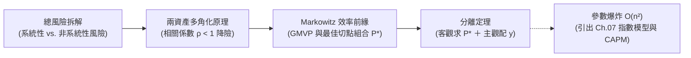

# Ch.06 效率多角化與投資組合理論 (Efficient Diversification)

## 本章核心問題與學習地圖

本章直接回應 [[ch05-risk-and-return|Ch.05 風險與報酬]] 中 [[capital-allocation-line|資本配置線 (CAL)]] 留下的核心問題：**面對市場上眾多風險性資產，投資人該如何利用多角化降低風險，並組出斜率最陡的最佳風險性投資組合 $P^*$？**

---

## 本章核心知識拆解

### 1. 風險拆解與多角化原理
- 詳見 [[systematic-vs-unsystematic-risk|系統性風險與非系統性風險]]
- 重點摘要：
  - 總風險可區分為不可分散的**系統性風險 (Systematic Risk)** 與可透過多角化消除的**非系統性風險 (Unsystematic / Firm-Specific Risk)**。
  - 在兩資產投資組合中，只要相關係數 $\rho_{DE} < 1$，組合標準差 $\sigma_P$ 必嚴格小於個別資產標準差的加權平均；當 $\rho_{DE} = -1$ 時，甚至可建構零風險組合。

### 2. 馬可維茲投資組合選擇模型與分離定理
- 詳見 [[markowitz-portfolio-theory|馬可維茲投資組合理論 (Markowitz)]]
- 重點摘要：
  - 透過所有可行權重組出**最小變異數前緣 (Minimum-Variance Frontier)**，其位於全域最小變異數組合 (GMVP) 上方的半支即為**效率前緣 (Efficient Frontier)**。
  - 從無風險利率 $r_f$ 出發畫出與效率前緣相切的 [[capital-allocation-line|資本配置線 (CAL)]]，切點即為使 [[sharpe-ratio|夏普比率 (Sharpe Ratio)]] 最大化的**最佳風險性投資組合 $P^*$**。
  - **分離定理 (Separation Property)** 將投資決策切割為兩獨立步驟：先客觀找出最佳風險組合 $P^*$，再依個人風險趨避程度決定配置比例 $y$。

---

## 核心公式速查

$$
E(r_P) = w_D E(r_D) + w_E E(r_E), \qquad w_D + w_E = 1
$$

$$
\sigma_P^2 = w_D^2 \sigma_D^2 + w_E^2 \sigma_E^2 + 2 w_D w_E\,\text{Cov}(r_D, r_E), \qquad \text{Cov}(r_D, r_E) = \rho_{DE}\sigma_D\sigma_E
$$

$$
\text{Markowitz 估計參數總數} = n + n + \frac{n(n-1)}{2} = \frac{n^2 + 3n}{2} = O(n^2)
$$

---

## 跨章節脈絡銜接

- **承接 [[ch05-risk-and-return|Ch.05 風險與報酬]]**：補上 [[capital-allocation-line|CAL]] 缺少的「最佳風險組合 $P^*$ 建構方法」，並將 [[risk-and-risk-premium|總風險 $\sigma^2$]] 進一步區分為系統性與非系統性兩部分。
- **銜接 [[ch07-capm-and-apt|Ch.07 CAPM 與多因子定價理論]]**：
  - 針對 Markowitz 估計參數量達 $O(n^2)$ 的實務痛點，Ch.07 提出 [[single-index-model|單因子指數模型]] 將估計量大幅壓低至 $3n + 2$。
  - 在同質預期與市場均衡下，所有投資人的最佳切點組合 $P^*$ 收斂為市場投資組合 $M$，使切線 CAL 成為 CML，並導出 [[capm|資本資產定價模型 (CAPM)]] 與 [[cal-cml-sml-comparison|CAL、CML 與 SML 比較]]。
