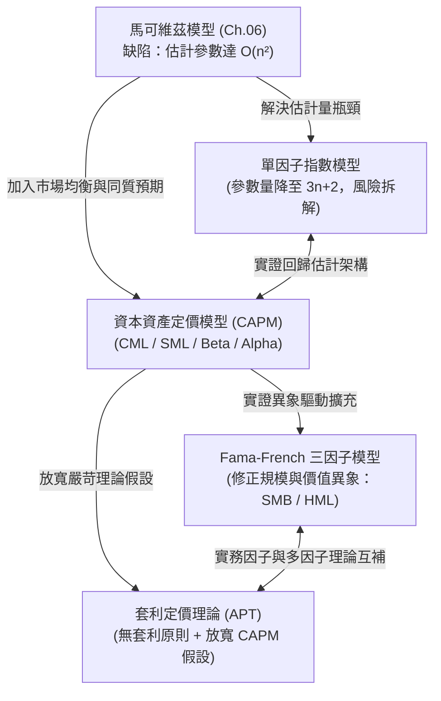

# Ch.07 CAPM 與多因子定價理論 (CAPM and Arbitrage Pricing Theory)

## 本章核心問題與學習地圖

本章將 [[ch06-efficient-diversification|Ch.06 效率多角化]] 的投資組合選擇理論推展至「**整個資本市場的均衡資產定價**」，同時呈現現代定價理論如何沿著「克服缺陷 → 簡化估計／擴充因子／放寬假設」的主軸持續演進：

---

## 本章核心知識拆解

### 1. 資本資產定價模型 (CAPM) 與核心指標
- 詳見 [[capm|資本資產定價模型 (CAPM)]]、[[beta-and-alpha|貝他係數與詹森阿法 (Beta & Alpha)]]、[[cal-cml-sml-comparison|CAL、CML 與 SML 比較]]
- 重點摘要：
  - 在同質預期與無摩擦均衡市場下，所有投資人的最佳風險組合收斂為**市場投資組合 (Market Portfolio, $M$)**，切線 CAL 特化為**資本市場線 (Capital Market Line, CML)**。
  - 個別資產與投資組合的均衡期望報酬由**證券市場線 (Security Market Line, SML)** 決定，僅對系統性風險 $\beta_i$ 給予補償；偏離 SML 的程度即為錯誤定價指標 $\alpha_i$（均衡時 $\alpha_i = 0$）。

### 2. 單因子指數模型 (Single-Index Model)
- 詳見 [[single-index-model|單因子指數模型]]
- 重點摘要：
  - 直接解決 [[markowitz-portfolio-theory|Markowitz 模型]] 共變異數估計參數量高達 $O(n^2)$ 的實務障礙，將總風險明確拆解為系統性風險 $\beta_i^2 \sigma_M^2$ 與公司特有風險 $\sigma^2(e_i)$，並將待估計參數壓縮至 $3n + 2$ 個。

### 3. CAPM 實證異象與 Fama-French 三因子模型
- 詳見 [[fama-french-three-factor|Fama-French 三因子模型]]
- 重點摘要：
  - 實證發現單一市場因子 $\beta$ 無法解釋**規模效應 (Size Effect)** 與**價值效應 (Value Effect)**，因而引入規模因子 (SMB) 與價值因子 (HML) 建構三因子定價模型。

### 4. 套利定價理論 (APT) 與比較
- 詳見 [[apt|套利定價理論 (APT)]]、[[capm-vs-apt|CAPM 與 APT 比較]]
- 重點摘要：
  - 改以「無套利原則 (No-Arbitrage Principle)」推導多因子均衡定價，放寬 CAPM 對市場組合效率性與效用函數的嚴苛假設，但代價是僅保證適用於充分多角化投資組合且未指定具體風險因子。

---

## 核心公式速查

$$
\beta_i = \frac{\text{Cov}(r_i, r_M)}{\sigma_M^2}, \qquad E(r_i) = r_f + \beta_i\left[E(r_M) - r_f\right]
$$

$$
\alpha_i = E(r_i) - \left\{r_f + \beta_i\left[E(r_M) - r_f\right]\right\}
$$

$$
R_i = \alpha_i + \beta_i R_M + e_i, \qquad \sigma_i^2 = \beta_i^2 \sigma_M^2 + \sigma^2(e_i)
$$

$$
R_{it} = \alpha_i + \beta_{iM} R_{Mt} + \beta_{i,\text{SMB}}\,\text{SMB}_t + \beta_{i,\text{HML}}\,\text{HML}_t + e_{it}
$$

---

## 跨章節脈絡銜接

- **收束 Ch.05–Ch.07 資產定價主線**：從 [[ch05-risk-and-return|Ch.05]] 的單一風險組合配置 (CAL) → [[ch06-efficient-diversification|Ch.06]] 的最佳風險組合建構 (Markowitz) → 本章的均衡定價 (CAPM)、實務簡化 (Single-Index) 與多因子演進 (Fama-French / APT)。
- **銜接 [[ch08-efficient-market-hypothesis|Ch.08 效率市場假說 (EMH)]]**：CAPM 與單因子指數模型作為 [[event-study-and-anomalies|事件研究法]] 估算正常報酬 $E(r_t)$ 的基準，並檢驗市場是否滿足 [[beta-and-alpha|$\alpha_i = 0$]]。
- **銜接 [[ch09-behavioral-finance|Ch.09 行為財務學與技術分析]]**：[[behavioral-finance-and-prospect-theory|行為財務學]] 為規模／價值等異象提供非理性定價詮釋，且 [[limits-to-arbitrage|套利限制]] 揭示 [[apt|APT]] 無套利機制在現實市場面臨的摩擦（對照見 [[emh-vs-behavioral-finance|EMH 與行為財務學比較]]）。
- **後續延伸（待匯入章節）**：Ch.18 投資組合績效評估中對 [[beta-and-alpha|Jensen's Alpha]] 與 [[sharpe-ratio|夏普比率]] 的實務運用。
