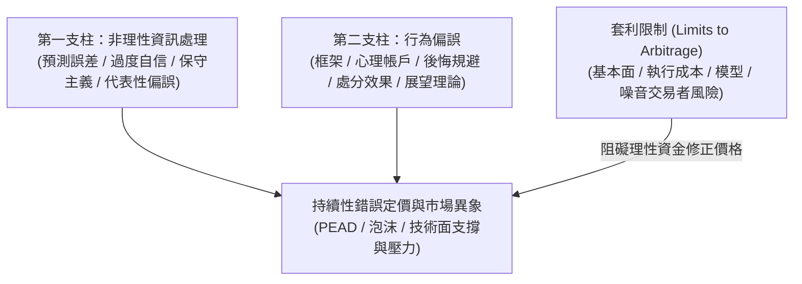

# Ch.09 行為財務學與技術分析 (Behavioral Finance and Technical Analysis)

## 本章核心問題與學習地圖

針對 [[ch08-efficient-market-hypothesis|Ch.08 效率市場假說 (EMH)]] 無法解釋市場泡沫、過度反應與盈餘公告後漂移 (PEAD) 等現象，本章從心理學與現實市場摩擦切入，回答：**為何投資人會系統性偏離理性？又為何理性套利者無法徹底把錯誤定價拉回基本面？**

---

## 本章核心知識拆解

### 1. 行為財務學兩大支柱與展望理論
- 詳見 [[behavioral-finance-and-prospect-theory|行為財務學與展望理論]]
- 重點摘要：
  - **非理性資訊處理 (Information Processing Errors)**：預測誤差、過度自信（過度交易降報酬）、保守主義（解釋 Ch.08 PEAD 漂移）、樣本數忽略與代表性偏誤（導致過度反應與反轉）。
  - **行為偏誤 (Behavioral Biases)**：框架效應、心理帳戶（直接衝擊 Ch.06 [[markowitz-portfolio-theory|Markowitz 整體組合最佳化]]）、後悔規避（引發羊群效應）、處分效果（賣贏抱輸），以及 Kahneman 與 Tversky 提出的**展望理論 (Prospect Theory)**。
  - **技術分析連結**：處分效果與參考點錨定可為支撐線／壓力線提供心理學詮釋，但實務仍須警惕交易成本與資料探勘偏誤 (Data Mining)。

### 2. 套利限制 (Limits to Arbitrage)
- 詳見 [[limits-to-arbitrage|套利限制 (Limits to Arbitrage)]]
- 重點摘要：
  - 即使錯誤定價明顯存在，基本面風險、執行成本與放空限制、模型風險及**噪音交易者風險**（如 Royal Dutch / Shell 雙重上市長期價差）皆會迫使理性套利者裹足不前或提前停損。

---

## 跨章節脈絡銜接

- **全面挑戰古典理性財務學**：
  - 挑戰 [[ch08-efficient-market-hypothesis|Ch.08 EMH]]（完整對照見 [[emh-vs-behavioral-finance|效率市場假說與行為財務學比較]]）。
  - 心理帳戶挑戰 [[markowitz-portfolio-theory|Ch.06 馬可維茲模型]] 的整體風險共變最佳化原則。
  - [[limits-to-arbitrage|套利限制]] 揭示 [[apt|Ch.07 套利定價理論 (APT)]] 無套利假設在現實市場面臨的摩擦邊界。
  - 保守主義與代表性偏誤為 [[event-study-and-anomalies|Ch.08 市場異象]] 與 [[fama-french-three-factor|Ch.07 Fama-French 規模／價值效應]] 提供非理性錯誤定價的替代詮釋。
