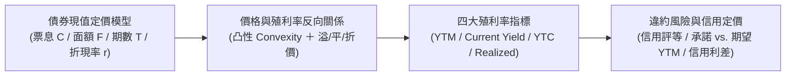

# Ch.10 債券價格與殖利率 (Bond Prices and Yields)

## 本章核心問題與學習地圖

本章由權益證券與資本市場理論正式邁入**固定收益證券 (Fixed-Income Securities)** 領域，建立債券評價的三大基石：
1. **債券如何定價？** 透過未來票息與面額折現決定價格，並掌握價格與殖利率間的反向凸性關係。
2. **如何正確衡量債券報酬？** 辨析到期殖利率 (YTM)、當期殖利率、贖回殖利率 (YTC) 與已實現複利報酬率的適用邊界。
3. **信用違約如何影響定價？** 區分承諾殖利率與期望殖利率，並理解信用評等與信用利差 (Credit Spread)。

---

## 本章核心知識拆解

### 1. 債券特性、現值定價與凸性
- 詳見 [[bond-pricing-model|債券現值定價模型]]
- 重點摘要：
  - 債券價格等於各期票息 $C$ 與到期面額 $F$（通常為 USD 1,000）依市場折現率 $r$ 折現之總和。
  - 債券價格與殖利率呈反向關係且具**凸性 (Convexity)**——利率下跌的漲幅大於等幅利率上升的跌幅；依票面利率與殖利率大小區分溢價、平價與折價債券。

### 2. 債券殖利率衡量指標
- 詳見 [[bond-yield-measures|債券殖利率衡量指標]]
- 重點摘要：
  - **到期殖利率 (YTM)** 隱含「所有票息皆能以相同 YTM 再投資」之強假設；**當期殖利率**忽略資本利得／損失；可贖回債券於利率大跌時應改看**贖回殖利率 (YTC)**；**已實現複利報酬率**則反映真實再投資利率變動。

### 3. 違約風險、信用評等與信用利差
- 詳見 [[default-risk-and-credit-spread|違約風險、信用評等與信用利差]]
- 重點摘要：
  - 信用評等劃分投資級債券（BBB/Baa 以上）與投機級／高收益債券；須區分「假設絕不違約」的**承諾 YTM** 與「納入違約機率及回收率」的**期望 YTM**，並以**信用利差 (Credit Spread)** 衡量信用風險補償。

---

## 核心公式速查

$$
P_B = \sum_{t=1}^{T} \frac{C}{(1 + r)^t} + \frac{F}{(1 + r)^T} = C\left[\frac{1 - (1 + r)^{-T}}{r}\right] + \frac{F}{(1 + r)^T}
$$

$$
\text{Current Yield} = \frac{\text{Annual Coupon}}{P_B}, \qquad \text{Credit Spread} = \text{Stated YTM}_{\text{corp}} - \text{YTM}_{\text{Treasury}}
$$

---

## 跨章節脈絡銜接

- **與 Ch.05–Ch.07 之關聯**：公債殖利率常作為 [[risk-and-risk-premium|無風險利率 $r_f$]] 之市場基準；公司債信用利差則呼應風險溢酬概念，反映違約風險之事前補償。
- **銜接後續固定收益章節（待匯入）**：本章假設單一平坦折現率 $r$ 並定性提及凸性，後續將延伸至**利率期限結構 (Term Structure of Interest Rates)**、**存續期間 (Duration)** 與**債券投資組合免疫策略 (Immunization)**。
