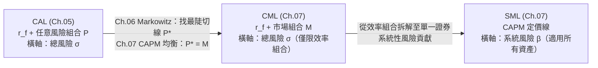

# CAL、CML 與 SML 比較 (CAL vs. CML vs. SML)

## 比較背景

從 [[ch05-risk-and-return|Ch.05]] 到 [[ch07-capm-and-apt|Ch.07]]，《投資學》依序出現三條長相極為相似的線性方程式：**資本配置線 (CAL)**、**資本市場線 (CML)** 與**證券市場線 (SML)**。三者縱軸皆為期望報酬率 $E(r)$、縱軸截距皆為無風險利率 $r_f$，但**橫軸的風險衡量尺規、斜率經濟意義與適用標的**截然不同，是投資學最核心也最常考的辨析題。

---

## 核心維度對照表

| 比較維度 | 資本配置線 ([[capital-allocation-line\|CAL]]) | 資本市場線 (CML) | 證券市場線 (SML) |
| :--- | :--- | :--- | :--- |
| **出現章節** | [[ch05-risk-and-return\|Ch.05]] ＆ [[ch06-efficient-diversification\|Ch.06]] | [[ch06-efficient-diversification\|Ch.06]] ＆ [[ch07-capm-and-apt\|Ch.07]] | [[ch07-capm-and-apt\|Ch.07]] ([[capm\|CAPM]]) |
| **橫軸（風險衡量）** | **總風險 $\sigma_C$**（標準差） | **總風險 $\sigma_C$**（標準差） | **系統性風險 $\beta_i$**（Beta 係數） |
| **縱軸** | 期望報酬率 $E(r_C)$ | 期望報酬率 $E(r_C)$ | 期望報酬率 $E(r_i)$ |
| **縱軸截距** | 無風險利率 $r_f$ | 無風險利率 $r_f$ | 無風險利率 $r_f$ |
| **斜率公式與意義** | $S_P = \frac{E(r_P) - r_f}{\sigma_P}$ （既定風險組合 $P$ 之[[sharpe-ratio\|夏普比率]]） | $S_M = \frac{E(r_M) - r_f}{\sigma_M}$ （市場組合 $M$ 之[[sharpe-ratio\|夏普比率]]） | $E(r_M) - r_f$ （市場[[risk-and-risk-premium\|風險溢酬]]） |
| **適用投資標的** | 由 $r_f$ 與任一既定風險組合 $P$ 構成之**完整投資組合 $C$** | 僅適用由 $r_f$ 與市場組合 $M$ 構成之**效率投資組合**（個別股票必落在 CML 下方） | 均衡下適用於**任何個別證券**與**任何投資組合**（不論是否充分多角化） |
| **與另外兩線之關係** | 最一般化的配置線 | **CAL 的均衡特例**：當 $P = P^* = M$ 時，最陡切線 CAL 即為 CML | **CAPM 的核心定價線**：衡量個別資產合理報酬與 [[beta-and-alpha\|$\alpha_i$]] 錯誤定價 |

---

## 三線方程式並列對照

$$
\text{CAL: } E(r_C) = r_f + \left[\frac{E(r_P) - r_f}{\sigma_P}\right]\sigma_C
$$

$$
\text{CML: } E(r_C) = r_f + \left[\frac{E(r_M) - r_f}{\sigma_M}\right]\sigma_C
$$

$$
\text{SML: } E(r_i) = r_f + \beta_i\left[E(r_M) - r_f\right]
$$

---

## 演進脈絡與考題判別要點

1. **「個別股票」在 CML 與 SML 上的位置（高頻考題陷阱）**：
   - 在均衡市場下，個別股票雖然合理定價（$\alpha_i = 0$，**恰好落在 SML 線上**），但因個別股票含有尚未分散的非系統性風險 $\sigma^2(e_i)$，其總風險 $\sigma_i$ 偏高，因此**必然落在 CML 的下方**。
2. **橫軸判別口訣**：
   - 看到「C」開頭（**C**AL、**C**ML）→ 討論**完整／效率投資組合 (Complete Portfolio)** → 橫軸一律是**總風險 $\sigma$**，斜率是**夏普比率**。
   - 看到「S」開頭（**S**ML）→ 討論**個別證券定價 (Security)** → 橫軸一律是**系統風險 $\beta$**，斜率是**市場風險溢酬 $E(r_M) - r_f$**。

---

## 關聯連結
- [[capital-allocation-line|資本配置線 (CAL)]]
- [[markowitz-portfolio-theory|馬可維茲投資組合理論 (Markowitz)]]
- [[capm|資本資產定價模型 (CAPM)]]
- [[sharpe-ratio|夏普比率 (Sharpe Ratio)]]
- [[beta-and-alpha|貝他係數與詹森阿法 (Beta & Alpha)]]
