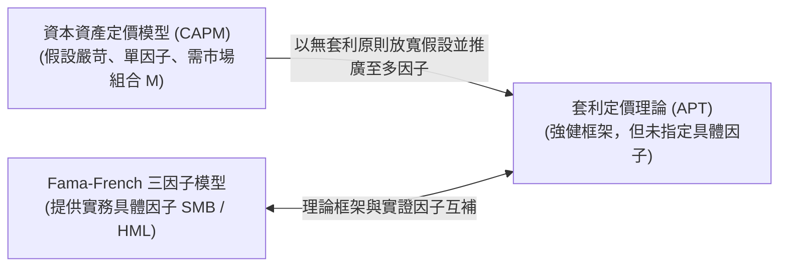

# 套利定價理論 (Arbitrage Pricing Theory, APT)

## 核心直覺

套利定價理論 (Arbitrage Pricing Theory, APT) 不像 [[capm|CAPM]] 依賴「所有投資人皆為均值—變異數最佳化者」與「市場投資組合必須有效率」等嚴苛均衡假設，而是建立在更為簡潔強健的**無套利原則 (No-Arbitrage Principle)** 之上。

只要證券報酬由多因子線性過程生成，且市場中存在足夠多的證券可供充分多角化消除非系統性風險，那麼**任何兩個對系統性因子曝險完全相同的充分多角化投資組合，其期望報酬率必定相等**；否則投資人只需「做多高報酬組合、放空低報酬組合」即可零風險無成本套利，迅速將價格推回無套利均衡。

---

## 核心假設 (Key Assumptions)

1. **多因子報酬生成過程**：證券報酬率可由數個共同系統性因子與一個公司特有殘差項線性描述。
2. **證券數量足夠龐大**：市場上有足夠多的證券，能建構出非系統性風險完全消除的**充分多角化投資組合 (Well-Diversified Portfolio)**。
3. **無套利機會 (No-Arbitrage Condition)**：運作良好的資本市場不允許持續存在零淨投資、零風險卻具正報酬的套利機會（單一價格法則）。

> 相較於 [[capm|CAPM]]，APT **不需要**假設報酬服從常態分配、投資人具備二次效用函數，也不需要市場投資組合 $M$ 具備均值—變異數效率性。

---

## 標準 LaTeX 公式與符號定義

### 1. 多因子報酬生成過程（以 $K$ 個系統因子為例）

$$
r_i = E(r_i) + \beta_{i1} F_1 + \beta_{i2} F_2 + \dots + \beta_{iK} F_K + e_i
$$

### 2. 充分多角化投資組合之無套利均衡定價式
對於充分多角化投資組合 $P$（其非系統性風險 $e_P \approx 0$），無套利原則要求期望報酬率必須與各系統因子的風險曝險呈線性關係：

$$
E(r_P) = r_f + \beta_{P1}\,RP_1 + \beta_{P2}\,RP_2 + \dots + \beta_{PK}\,RP_K = r_f + \sum_{k=1}^{K} \beta_{Pk}\,RP_k
$$

其中 $RP_k = E(r_{Fk}) - r_f$ 為第 $k$ 個系統風險因子對應之**因子風險溢酬 (Factor Risk Premium)**。

| 符號 | 經濟意義 |
| :--- | :--- |
| $F_k$ | 第 $k$ 個系統性總體風險因子之未預期衝擊（滿足 $E(F_k) = 0$） |
| $\beta_{ik},\, \beta_{Pk}$ | 資產 $i$ 或充分多角化組合 $P$ 對第 $k$ 個系統性因子之敏感度（因子負荷量） |
| $RP_k = E(r_{Fk}) - r_f$ | 承擔一單位第 $k$ 因子風險所獲得之均衡風險溢酬 |
| $e_i$ | 公司特有非系統性殘差項（在充分多角化組合 $P$ 中趨近於 $0$） |

---

## 無套利機制如何恢復均衡？

假設存在兩個充分多角化投資組合 $A$ 與 $B$，具有完全相同的因子敏感度（$\beta_{Ak} = \beta_{Bk}$），但 $E(r_A) > E(r_B)$：
1. **建構套利組合**：放空組合 $B$、以所得資金等額買進組合 $A$（淨期初投入為 $0$）。
2. **風險抵銷**：兩組合的系統性因子曝險互相抵銷，且皆已充分多角化而無公司特有風險，故此套利策略為**無風險**。
3. **價格收斂**：投資人無限放大此零成本正報酬交易，推升 $A$ 的價格（壓低 $E(r_A)$）並壓低 $B$ 的價格（推升 $E(r_B)$），直到 $E(r_A) = E(r_B)$ 恢復無套利均衡。

---

## 模型缺陷與限制 (Limitations & Critiques)

1. **僅嚴格適用於「充分多角化投資組合」**：APT 無法保證每一檔**個別股票**都沒有定價誤差（單一證券仍含不可忽視的公司特有風險 $e_i$，無法僅靠該單一股票建構完美無風險套利；理論上僅保證「幾乎所有」個別證券近似成立）。
2. **未指定具體的風險因子與因子個數**：APT 僅提出「多因子線性定價」的數學框架，但理論本身**並未說明具體應該放入哪些總體或市場因子**（實務上須搭配經驗研究如 [[fama-french-three-factor|Fama-French 三因子模型]] 或總體變數挑選因子）。
3. **現實市場存在套利障礙（Ch.09）**：在真實市場中，[[limits-to-arbitrage|套利限制 (Limits to Arbitrage)]]（基本面風險、執行與放空成本、模型風險與噪音交易者風險）可能使無套利價格收斂受阻。

---

## 模型演進鏈 (Model Evolution)

- **理論前身 / 對應模型**：
  - [[capm|資本資產定價模型 (CAPM)]]（APT 克服其市場組合不可觀測與嚴苛效用／分配假設之限制；詳細異同見 [[capm-vs-apt|CAPM 與 APT 比較]]）
  - [[single-index-model|單因子指數模型]]（單因子架構可視為 APT 的最簡特例）
- **實務互補模型**：
  - [[fama-french-three-factor|Fama-French 三因子模型]]（提供具體且可交易的實證因子投資組合，彌補 APT 未指定因子的缺口）
- **所屬章節**：[[ch07-capm-and-apt|Ch.07 CAPM 與多因子定價理論]]
