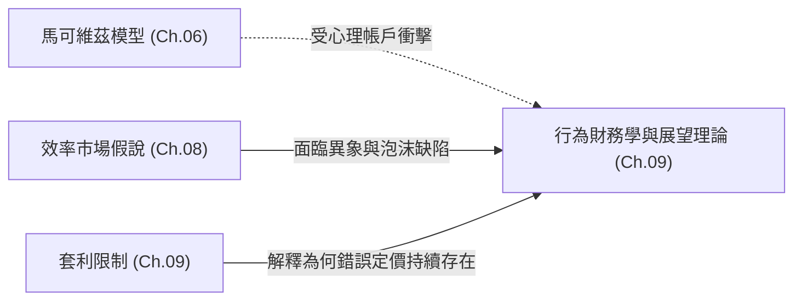

# 行為財務學與展望理論 (Behavioral Finance & Prospect Theory)

## 核心直覺

行為財務學 (Behavioral Finance) 放寬傳統金融學「投資人完全理性」的假設，主張市場之所以會持續出現錯誤定價與泡沫，源於兩道結構性防線的失效：**（1）人類在處理資訊與做決策時存在系統性的心理偏誤**；**（2）理性資金受限於 [[limits-to-arbitrage|套利限制]]，無法徹底糾正這些價格偏離**。

---

## 核心假設 (Key Assumptions)

1. **有限理性 (Bounded Rationality)**：投資人在資訊處理與風險評估上會系統性偏離貝氏更新與標準期望效用理論。
2. **參考點依賴與損失規避**：依 Kahneman 與 Tversky 的**展望理論 (Prospect Theory)**，投資人評估效用的對象是相對於參考點的**財富變動量 ($\Delta W = W - W_0$)**，而非傳統理論的最終財富水準 ($W$)。
3. **套利並非無成本或無風險**：實務中存在 [[limits-to-arbitrage|套利限制]]，使非理性情緒足以長時間扭曲資產價格。

---

## 行為財務學兩大支柱

### 第一支柱：非理性資訊處理 (Information Processing Errors)

| 偏誤類型 | 心理機制 | 對市場價格或投資績效之影響 |
| :--- | :--- | :--- |
| **預測誤差 (Forecasting Errors)** | 過度看重近期經驗（近因偏誤），忽略長期基準機率 | 過度外推近期盈餘或市場走勢，放大估值波動 |
| **過度自信 (Overconfidence)** | 高估自身預測能力與資訊精準度 | 導致**過度交易**，增加手續費與稅負並顯著拉低淨報酬 |
| **保守主義偏誤 (Conservatism)** | 對新資訊更新信念的速度過慢 | 導致股價在盈餘公告後緩慢調整，直接解釋 Ch.08 之 [[event-study-and-anomalies\|PEAD 漂移異象]] |
| **樣本數忽略與代表性偏誤** | 誤將短期連續漲跌視為長期確定趨勢 | 造成價格**過度反應 (Overreaction)**，隨後引發均值回歸反轉 |

### 第二支柱：行為偏誤 (Behavioral Biases)

1. **框架效應 (Framing)**：同一財務問題僅因呈現方式不同（框定為「獲利」或「損失」），便會改變投資人的風險偏好與決策。
2. **心理帳戶 (Mental Accounting)**：將不同來源或用途的資金分開記帳管理（例如將安全儲蓄與投機資金分開），違背整體投資組合共變異數最佳化原則，直接衝擊 Ch.06 [[markowitz-portfolio-theory|馬可維茲投資組合理論]]。
3. **後悔規避 (Regret Avoidance)**：害怕做出非傳統投資決策失誤後承受更強烈的後悔感，傾向跟隨大眾買進熱門主流股，助長**羊群效應 (Herding)**。
4. **處分效果 (Disposition Effect)**：投資人傾向**過早賣出獲利股票**（急於鎖定獲利），卻**過久抱牢虧損股票**（逃避將帳面虧損實現）。
5. **展望理論 (Prospect Theory)**：行為決策最核心的效用架構（詳見下節）。

---

## 展望理論 (Prospect Theory) 核心數學特徵與符號說明

相較於傳統投資學以最終財富水準 $W$ 定義凹性效用函數 $U(W)$，展望理論將價值函數 $v(\Delta W)$ 定義在相對於參考點 $W_0$ 的財富變動量 $\Delta W = W - W_0$ 上：

$$
\Delta W = W - W_0, \qquad
\begin{cases}
v''(\Delta W) < 0 & \text{獲利區 } (\Delta W > 0)\text{：呈凹性（風險趨避）} \\
v''(\Delta W) > 0 & \text{損失區 } (\Delta W < 0)\text{：呈凸性（風險愛好）} \\
|v(-x)| > v(x) & \text{損失規避 (Loss Aversion)，對 } x > 0
\end{cases}
$$

| 符號 | 經濟與心理意義 |
| :--- | :--- |
| $W,\, W_0$ | 投資人期末財富水準與心理參考點（如買進成本價） |
| $\Delta W = W - W_0$ | 相對於參考點之財富變動量（獲利或損失） |
| $v(\Delta W)$ | 展望理論之 S 型價值函數（在原點呈現折點，損失區斜率遠陡於獲利區） |
| $\|v(-x)\| > v(x)$ | **損失規避 (Loss Aversion)**：蒙受 $x$ 元損失的痛苦遠大於獲得 $x$ 元獲利的快樂，進而解釋處分效果（套牢時寧可賭一把抱牢，也不願認賠） |

---

## 與技術分析的連結 (Technical Analysis)

- 技術分析試圖從歷史價格趨勢、支撐線／壓力線與市場情緒指標中尋找可交易規律。
- 行為財務學為部分技術面現象提供了心理學基礎（例如**處分效果**與**參考點錨定**會使套牢投資人在「解套成本價」集中賣出，形成價格阻力位）。
- **實證警示**：即便心理機制確實存在，將技術指標轉化為穩定獲利仍須面對交易成本、套利修正以及**資料探勘偏誤 (Data Mining)** 的嚴峻考驗。

---

## 模型缺陷與限制 (Limitations & Critiques)

1. **缺乏統一的定量定價方程式**：不像 [[capm|CAPM]] 或 [[fama-french-three-factor|Fama-French 三因子模型]] 能直接計算單一明確的要求報酬率，行為財務學包含數十種心理偏誤，不同偏誤間有時甚至會導出相反預測（如保守主義預測反應不足，代表性偏誤預測過度反應）。
2. **容易流於事後詮釋與資料探勘偏誤**：若缺乏事前明確邊界條件，容易針對任何歷史異象事後挑選對應的心理偏誤來解釋。
3. **未能完全證明市場存在輕鬆暴利**：如同 Ch.08 共同基金實證所示，即使投資人非理性，由於 [[limits-to-arbitrage|套利限制]] 與交易成本，實務上要穩定擊敗大盤依然極度困難。

---

## 模型演進鏈 (Model Evolution)

- **直接挑戰之古典理論**：
  - [[efficient-market-hypothesis|效率市場假說 (EMH)]]（完整論戰對照見 [[emh-vs-behavioral-finance|效率市場假說與行為財務學比較]]）
  - [[markowitz-portfolio-theory|馬可維茲投資組合理論]]（心理帳戶違背整體組合分散最佳化原則）
  - [[fama-french-three-factor|Fama-French 三因子模型]]（為規模／價值效應提供非理性定價之替代解釋）
- **結構性搭配概念**：
  - [[limits-to-arbitrage|套利限制 (Limits to Arbitrage)]]
  - [[event-study-and-anomalies|事件研究法與市場異象]]（保守主義解釋 PEAD）
- **所屬章節**：[[ch09-behavioral-finance|Ch.09 行為財務學與技術分析]]
