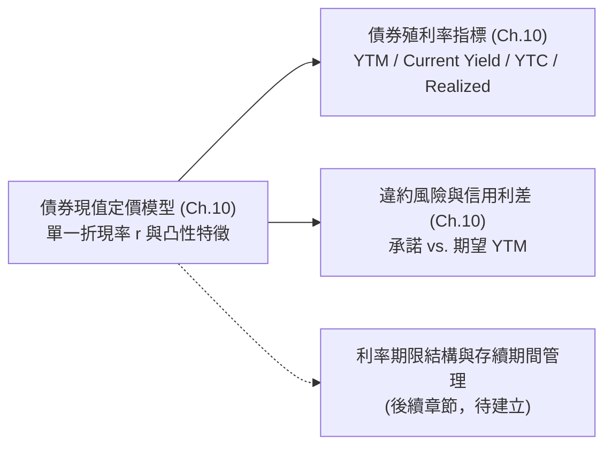

# 債券現值定價模型 (Bond Present Value Pricing Model)

## 核心直覺

債券本質上是一張承諾未來定期支付固定現金流的契約。因此，債券的理論合理價格 ($P_B$) 等於其未來每一期**票息收入 ($C$)** 與到期日償還之**面額 ($F$)**，依照當前市場要求報酬率（折現率 $r$）折算回今天的現值總和。

---

## 核心假設 (Key Assumptions)

1. **確定性現金流（基礎無違約設定）**：假設發行人將如期全額支付各期票息 $C$ 與到期面額 $F$（若考慮違約風險，須延伸至 [[default-risk-and-credit-spread|承諾與期望 YTM 及信用利差]]）。
2. **單一平坦折現率**：基礎定價式對所有到期期數 $t = 1, \dots, T$ 套用相同的折現率 $r$（即假設殖利率曲線為水平，且票息再投資報酬率固定）。
3. **無隱含選擇權（標準純債）**：不含可贖回 (Callable) 或可賣回等提前終止條款（含權債券須改採 [[bond-yield-measures|贖回殖利率 (YTC)]] 等調整評價）。

---

## 標準 LaTeX 公式與符號定義

### 1. 逐期折現級數形式

$$
P_B = \sum_{t=1}^{T} \frac{C}{(1 + r)^t} + \frac{F}{(1 + r)^T}
$$

### 2. 年金現值因子精簡形式

$$
P_B = C \left[\frac{1 - (1 + r)^{-T}}{r}\right] + \frac{F}{(1 + r)^T}
$$

| 符號 | 經濟意義 |
| :--- | :--- |
| $P_B$ | 債券當期理論價格 (Bond Price) |
| $F$ | 債券面額 (Par Value / Face Value)，實務通常為 USD 1,000 |
| $C$ | 每期支付之票息金額（等於 $F \times \text{每期票面利率}$） |
| $T$ | 距離到期之剩餘總期數 (Maturity) |
| $r$ | 每期市場折現率／要求報酬率（若令公式等於市價求解，該 $r$ 即為 [[bond-yield-measures\|到期殖利率 (YTM)]]） |

---

## 價格與殖利率的反向凸性關係

1. **反向凸性曲線 (Inverse & Convex Relationship)**：
   - 當市場要求報酬率 $r$ 上升，折現分母變大，債券價格 $P_B$ 下跌；反之 $r$ 下降則 $P_B$ 上漲。
   - 價格對殖利率的函數圖形呈向原點凸出之曲線，稱為**凸性 (Convexity)**：**利率下跌帶來的價格漲幅，大於等幅度利率上升所造成的價格跌幅**（對債券持有人有利）。
2. **溢價、平價與折價債券判別**：

| 債券類型 | 票面利率 vs. 市場殖利率 | 債券市價 vs. 面額 |
| :--- | :---: | :---: |
| **溢價債券 (Premium Bond)** | $\text{Coupon Rate} > \text{YTM}$ | $P_B > F$ |
| **平價債券 (Par Bond)** | $\text{Coupon Rate} = \text{YTM}$ | $P_B = F$ |
| **折價債券 (Discount Bond)** | $\text{Coupon Rate} < \text{YTM}$ | $P_B < F$ |

---

## 模型缺陷與限制 (Limitations & Critiques)

1. **單一折現率假設忽略利率期限結構**：現實市場中不同到期日對應不同的即期利率 (Spot Rates)，單一 $r$ 無法捕捉向上或倒掛的殖利率曲線。
2. **未直接量化利率敏感度**：現值公式雖能算價格，但無法直觀比較不同票息與到期日債券的利率風險大小（須引入後續章節的存續期間與凸性指標）。
3. **未反映違約機率與含權條款**：公司債存在違約損失風險，可贖回債券於利率大跌時價格漲幅會受贖回價格壓抑（負凸性）。

---

## 模型演進鏈 (Model Evolution)

- **同章核心延伸**：
  - [[bond-yield-measures|債券殖利率衡量指標]]（由價格反推 YTM、YTC 與解決再投資率假設的已實現複利報酬率）
  - [[default-risk-and-credit-spread|違約風險、信用評等與信用利差]]（將違約機率與回收率納入債券定價）
- **後續章節演進（待後續章節建立）**：
  - 利率期限結構 (Term Structure of Interest Rates)（以各期即期利率取代單一折現率 $r$）
  - 存續期間與凸性管理 (Duration & Convexity)（精確量化債券利率風險與免疫策略）
- **所屬章節**：[[ch10-bond-prices-and-yields|Ch.10 債券價格與殖利率]]
