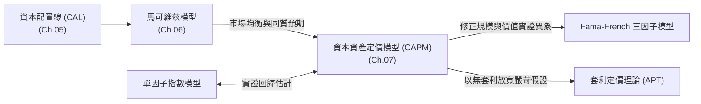

# 資本資產定價模型 (Capital Asset Pricing Model, CAPM)

## 核心直覺

資本資產定價模型 (Capital Asset Pricing Model, CAPM) 是現代財務經濟學的基石。它將 [[markowitz-portfolio-theory|馬可維茲投資組合理論]] 的個人最佳化決策推展至**全市場一般均衡**：當所有投資人皆理性最佳化且擁有相同預期時，大家持有的最佳風險組合 $P^*$ 必定完全一致，因此均衡時該組合就是涵蓋所有風險資產的**市場投資組合 (Market Portfolio, $M$)**。

在此均衡下，市場不會為可透過多角化免費消除的非系統性風險支付報酬；任何個別資產的合理期望報酬，**完全取決於其對市場組合的系統性風險貢獻度 $\beta_i$**。

---

## 核心假設 (Key Assumptions)

1. **理性均值—變異數最佳化者**：所有投資人皆為風險趨避者，僅依期望報酬與變異數進行最佳化。
2. **單一投資期間**：所有投資人的投資規劃期間相同。
3. **同質預期 (Homogeneous Expectations)**：所有投資人對各項資產的期望報酬、變異數與共變異數擁有一致的預期，因而看到同一條效率前緣與同一個切點組合。
4. **完全競爭與無摩擦市場**：所有投資人為價格接受者，市場無交易成本、無稅負、資產可無限分割。
5. **無風險自由借貸**：投資人皆可按相同的無風險利率 $r_f$ 無限制借入或貸出資金。

---

## 標準 LaTeX 公式與符號定義

### 1. 資本市場線 (Capital Market Line, CML)
均衡下最佳風險組合 $P^* = M$，連接無風險利率 $r_f$ 與市場投資組合 $M$ 的切線即為 CML（僅適用效率投資組合）：

$$
E(r_C) = r_f + \left[\frac{E(r_M) - r_f}{\sigma_M}\right]\sigma_C = r_f + S_M\,\sigma_C
$$

### 2. 貝他係數 (Beta) 與證券市場線 (Security Market Line, SML)
CAPM 的核心定價方程式（適用於**任何個別資產與投資組合**）：

$$
\beta_i = \frac{\text{Cov}(r_i, r_M)}{\sigma_M^2}
$$

$$
E(r_i) = r_f + \beta_i\left[E(r_M) - r_f\right]
$$

### 3. 錯誤定價指標：詹森阿法 (Jensen's Alpha)

$$
\alpha_i = E(r_i) - \left\{r_f + \beta_i\left[E(r_M) - r_f\right]\right\}
$$

在完全均衡市場下，所有資產皆落在 SML 上，滿足 $\alpha_i = 0$。

| 符號 | 經濟意義 |
| :--- | :--- |
| $M$ | 市場投資組合 (Market Portfolio)，依市值加權涵蓋所有風險資產 |
| $E(r_M),\, \sigma_M$ | 市場投資組合之期望報酬率與標準差 |
| $E(r_M) - r_f$ | 市場風險溢酬 (Market Risk Premium)，亦為 SML 之斜率 |
| $S_M$ | 市場投資組合之 [[sharpe-ratio\|夏普比率]]，亦為 CML 之斜率 |
| $\beta_i$ | 個別資產 $i$ 對市場系統性風險之敏感度（詳見 [[beta-and-alpha\|Beta 與 Alpha]]） |
| $\alpha_i$ | 實際期望報酬與 SML 理論報酬之差額（錯誤定價程度） |

---

## 模型缺陷與限制 (Limitations & Critiques)

1. **理論假設過於嚴苛**：現實中不存在完全同質預期、零交易成本、無稅負，且一般投資人的借款利率高於無風險利率 $r_f$。
2. **市場投資組合 $M$ 不可完全觀測**：理論上的 $M$ 須包含全球所有可交易與不可交易資產（股票、債券、房地產、人力資本等），實務上僅能以大盤指數（如 S&P 500）作為代理，造成實證檢定爭議。
3. **無法解釋實證市場異象 (Market Anomalies)**：大量實證研究指出，單一市場因子 $\beta$ 不足以完整解釋股票橫斷面報酬差異，特別是：
   - **規模效應 (Size Effect)**：小型股長期平均報酬顯著高於 CAPM 預測。
   - **價值效應 (Value Effect)**：高帳面市值比 (Book-to-Market, B/M) 的價值股長期報酬顯著高於 CAPM 預測。

---

## 模型演進鏈 (Model Evolution)

- **理論前身 / 基礎**：
  - [[capital-allocation-line|資本配置線 (CAL)]] 與 [[markowitz-portfolio-theory|馬可維茲投資組合理論]]（提供效率前緣與分離定理基礎）
  - [[single-index-model|單因子指數模型]]（提供實證估計 $\beta_i$ 與 $\alpha_i$ 的回歸架構）
- **核心指標與跨頁比較**：
  - [[beta-and-alpha|貝他係數與詹森阿法 (Beta & Alpha)]]
  - [[cal-cml-sml-comparison|CAL、CML 與 SML 比較]]
  - [[capm-vs-apt|CAPM 與 APT 比較]]
- **後續修正 / 延伸模型與實證檢定**：
  - [[fama-french-three-factor|Fama-French 三因子模型]]：在市場因子外納入 SMB（規模）與 HML（價值）因子，修正 CAPM 的橫斷面實證異象。
  - [[apt|套利定價理論 (APT)]]：改以無套利原則推導多因子均衡，不再需要市場組合效率性或常態／二次效用等嚴苛假設。
  - [[efficient-market-hypothesis|效率市場假說 (EMH)]] 與 [[event-study-and-anomalies|事件研究法與市場異象]]：以 CAPM 估算事件研究之正常報酬基準 $E(r_t)$，並進一步檢驗本益比、規模與 PEAD 異象。
  - [[behavioral-finance-and-prospect-theory|行為財務學與展望理論]]：從非理性心理偏誤與 [[limits-to-arbitrage|套利限制]] 重新詮釋 CAPM 無法解釋之市場異象。
- **所屬章節**：[[ch07-capm-and-apt|Ch.07 CAPM 與多因子定價理論]]
