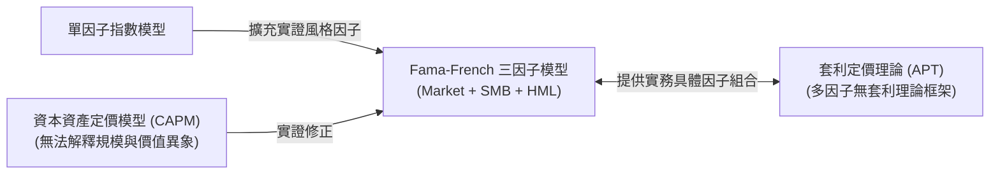

# Fama-French 三因子模型 (Fama-French Three-Factor Model)

## 核心直覺

針對 [[capm|資本資產定價模型 (CAPM)]] 僅以單一市場因子 $\beta$ 無法解釋股票橫斷面報酬的實證缺陷——尤其是**規模效應 (Size Effect)** 與**價值效應 (Value Effect)**——Fama 與 French 提出在市場超額報酬之外，額外納入**規模因子 (SMB)** 與**價值因子 (HML)** 兩個系統性風格因子，以更精準地捕捉股票的風險溢酬結構。

---

## 核心假設 (Key Assumptions)

1. **多維度系統性風險結構**：股票期望超額報酬由三個共同系統性因子驅動（整體市場風險、公司規模風險、帳面市值比價值風險），而非單一市場指數。
2. **因子投資組合可代理系統性風險**：透過建構零成本多空投資組合（做多小型股／放空大型股之 SMB；做多高 B/M 股／放空低 B/M 股之 HML），可有效衡量這些系統性風險溢酬。
3. **殘差為公司特有雜訊**：剔除三因子影響後的殘差項 $e_{it}$ 屬於非系統性公司特有波動，滿足 $E(e_{it}) = 0$。

---

## 標準 LaTeX 公式與符號定義

$$
R_{it} = \alpha_i + \beta_{iM} R_{Mt} + \beta_{i,\text{SMB}}\,\text{SMB}_t + \beta_{i,\text{HML}}\,\text{HML}_t + e_{it}
$$

| 符號 | 經濟意義 |
| :--- | :--- |
| $R_{it} = r_{it} - r_{ft}$ | 資產 $i$ 於第 $t$ 期之超額報酬率 |
| $R_{Mt} = r_{Mt} - r_{ft}$ | 市場投資組合於第 $t$ 期之超額報酬率（市場因子） |
| $\text{SMB}_t$ | **規模因子 (Small Minus Big)**：小型股投資組合報酬減去大型股投資組合報酬，捕捉**規模效應 (Size Effect)** |
| $\text{HML}_t$ | **價值因子 (High Minus Low)**：高帳面市值比 (B/M) 價值股報酬減去低帳面市值比成長股報酬，捕捉**價值效應 (Value Effect)** |
| $\beta_{iM},\, \beta_{i,\text{SMB}},\, \beta_{i,\text{HML}}$ | 資產 $i$ 對市場、規模與價值三個因子之風險敏感度（因子負荷量, Factor Loadings） |
| $\alpha_i$ | 控制三因子後之異常超額報酬（若三因子已完整解釋風險，均衡下應趨近於 $0$） |
| $e_{it}$ | 第 $t$ 期之公司特有殘差項 |

---

## 模型缺陷與限制 (Limitations & Critiques)

1. **實證驅動而非嚴密理論推導**：SMB 與 HML 是由歷史橫斷面資料歸納出的經驗因子，其背後的經濟風險本質長期存在爭議（究竟是反映財務困境等理性風險溢酬，還是源於行為金融學的投資人認知偏誤？）。
2. **仍存在未解釋之市場異象**：後續研究發現如**動能效應 (Momentum)**、獲利能力 (Profitability) 與投資風格 (Investment) 等現象，三因子模型仍無法完全吸收（進而催生 Carhart 四因子與 Fama-French 五因子等後續擴充）。
3. **因子溢酬具時變性**：SMB 與 HML 的風險溢酬在不同景氣循環或市場結構下可能長期失效甚至轉負。

---

## 模型演進鏈 (Model Evolution)

- **理論前身 / 基礎**：
  - [[capm|資本資產定價模型 (CAPM)]]（本模型直接針對其規模效應與價值效應實證缺陷進行修正）
  - [[single-index-model|單因子指數模型]]（本模型為其多因子線性回歸形式之直接擴充）
- **平行與後續延伸**：
  - [[apt|套利定價理論 (APT)]]：APT 提出一般化的多因子無套利定價理論，但未指明具體因子為何；Fama-French 三因子模型則在實務上填補了「具體風險因子選擇」的空缺。
  - [[event-study-and-anomalies|事件研究法與市場異象]]（Ch.08）：規模效應與本益比／價值效應等市場異象直接呼應 SMB 與 HML 因子。
  - [[behavioral-finance-and-prospect-theory|行為財務學與展望理論]] 與 [[emh-vs-behavioral-finance|EMH 與行為財務學比較]]（Ch.09）：為規模／價值溢酬提供「非理性錯誤定價」的替代詮釋，與理性風險補償說分庭抗禮。
  - **後續多因子擴充（待後續章節建立）**：Carhart 四因子模型（加入動能因子）、Fama-French 五因子模型。
- **所屬章節**：[[ch07-capm-and-apt|Ch.07 CAPM 與多因子定價理論]]
