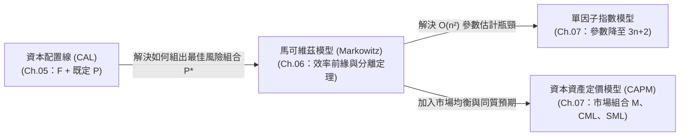

# 馬可維茲投資組合理論 (Markowitz Portfolio Selection Model)

## 核心直覺

馬可維茲投資組合理論 (Markowitz Portfolio Selection Model) 回答了 [[capital-allocation-line|資本配置線 (CAL)]] 尚未解決的核心問題：**面對眾多風險性資產，如何利用資產間的不完全相關性建構效率前緣，並找出能讓 CAL 斜率最陡（夏普比率最大）的最佳風險性投資組合 $P^*$？**

結合無風險資產後，更導出極具指導意義的**分離定理 (Separation Property)**：投資決策可完全拆分為「客觀尋找最佳風險組合 $P^*$」與「主觀決定無風險配置比例 $y$」兩個獨立步驟。

---

## 核心假設 (Key Assumptions)

1. **均值—變異數準則 (Mean-Variance Criterion)**：投資人為理性且風險趨避者，僅根據期望報酬率 $E(r_P)$ 與變異數 $\sigma_P^2$ 評估投資組合優劣。
2. **已知分配參數**：各風險資產的期望報酬率、變異數，以及任兩資產間的共變異數皆可事先估計取得。
3. **無風險利率存在（擴展至 $P^*$ 與分離定理時）**：存在固定無風險利率 $r_f$，可與效率前緣上的風險組合搭配構成 [[capital-allocation-line|CAL]]。

---

## 標準 LaTeX 公式與符號定義

### 1. 兩風險資產投資組合基礎公式
設風險組合 $P$ 由資產 $D$ 與資產 $E$ 組成（$w_D + w_E = 1$）：

$$
E(r_P) = w_D E(r_D) + w_E E(r_E)
$$

$$
\sigma_P^2 = w_D^2 \sigma_D^2 + w_E^2 \sigma_E^2 + 2 w_D w_E\,\text{Cov}(r_D, r_E)
$$

$$
\text{Cov}(r_D, r_E) = \rho_{DE}\,\sigma_D\,\sigma_E \qquad (-1 \le \rho_{DE} \le 1)
$$

### 2. 多資產最佳風險組合 $P^*$ 目標函數與估計參數量
在 $n$ 檔風險資產的可行集合上，尋找使 [[sharpe-ratio|夏普比率 (Sharpe Ratio)]] 最大的切點組合 $P^*$：

$$
\max_{\{w_i\}} S_P = \frac{E(r_P) - r_f}{\sigma_P} \qquad \text{s.t.} \quad \sum_{i=1}^{n} w_i = 1
$$

針對 $n$ 檔股票，完整共變異數矩陣所需估計的參數總數為：

$$
\text{Total Parameters} = \underbrace{n}_{\text{期望報酬}} + \underbrace{n}_{\text{變異數}} + \underbrace{\frac{n(n-1)}{2}}_{\text{共變異數}} = \frac{n^2 + 3n}{2} = O(n^2)
$$

| 符號 | 經濟意義 |
| :--- | :--- |
| $w_D,\, w_E,\, w_i$ | 各風險資產於投資組合中的資金權重 |
| $\text{Cov}(r_D, r_E)$ | 資產 $D$ 與資產 $E$ 之報酬共變異數 |
| $\rho_{DE}$ | 兩資產之相關係數；只要 $\rho_{DE} < 1$ 即具多角化降險效果，$\rho_{DE} = -1$ 可達零風險組合 |
| $P^*$ | **最佳風險性投資組合 (Optimal Risky Portfolio)**，即自 $r_f$ 引出之 CAL 與效率前緣的切點 |
| $n$ | 納入最佳化的風險性資產檔數 |

---

## 核心幾何結構與分離定理

1. **最小變異數前緣 (Minimum-Variance Frontier)**：在每一個給定的期望報酬水準下，能達成最低變異數的投資組合軌跡。
2. **全域最小變異數投資組合 (Global Minimum-Variance Portfolio, GMVP)**：最小變異數前緣最左側、總風險 $\sigma_P$ 絕對最小的組合。
3. **效率前緣 (Efficient Frontier)**：位於 GMVP **上方**的半支曲線；在此曲線上的組合，在相同風險水準下擁有最高期望報酬，嚴格支配下方組合。
4. **最佳風險性組合 $P^*$**：從無風險利率 $(0, r_f)$ 出發畫一條與效率前緣相切的 [[capital-allocation-line|CAL]]，切點即為夏普比率最大化的最佳風險組合 $P^*$（在市場均衡下此切線即成為 [[cal-cml-sml-comparison|資本市場線 (CML)]]）。
5. **分離定理 (Separation Property)**：
   - **步驟一（客觀技術面）**：找出唯一最佳風險組合 $P^*$（若預期相同，所有投資人的 $P^*$ 皆相同，與個人風險偏好無關）。
   - **步驟二（主觀偏好面）**：依個別投資人的風險趨避程度，沿著最佳 CAL 決定配置於 $P^*$ 與 $r_f$ 的資金比例 $y$。

---

## 模型缺陷與限制 (Limitations & Critiques)

1. **參數估計量爆炸（維度災難）**：對 $n$ 檔股票須估計 $\frac{n^2 + 3n}{2}$ 個參數（例如 $n = 1{,}000$ 檔股票便需估計超過 $50$ 萬個共變異數），計算成本極高。
2. **對估計誤差極度敏感**：歷史樣本估計出的期望報酬與共變異數常含大量雜訊，代入二次規劃最佳化後容易產生極端且不穩定的權重配置。
3. **未提供個別資產的市場均衡定價式**：模型聚焦於投資組合權重最佳化，尚待引入市場均衡條件以導出單一證券的合理報酬定價公式。
4. **面臨行為偏誤的實務挑戰（Ch.09）**：現實投資人常受 [[behavioral-finance-and-prospect-theory|心理帳戶 (Mental Accounting)]] 影響，將不同用途資金分開管理，違背本模型強調的「整體投資組合共變異數最佳化」原則。

---

## 模型演進鏈 (Model Evolution)

- **理論前身 / 基礎**：
  - [[capital-allocation-line|資本配置線 (CAL)]]（提供無風險資產與風險組合配置的框架，本模型補足最佳風險組合 $P^*$ 的建構方法）
  - [[systematic-vs-unsystematic-risk|系統性風險與非系統性風險]]（兩資產 $\rho < 1$ 多角化降險數學原理）
  - [[sharpe-ratio|夏普比率 (Sharpe Ratio)]]（決定最佳切點組合 $P^*$ 的目標函數）
- **後續修正 / 延伸模型**：
  - [[single-index-model|單因子指數模型 (Single-Index Model)]]：透過共同市場因子大幅簡化共變異數矩陣，將估計參數量從 $O(n^2)$ 降至 $3n + 2$。
  - [[capm|資本資產定價模型 (CAPM)]]：將分離定理推展至全市場均衡，推論出 $P^* = M$（市場投資組合），並導出 [[cal-cml-sml-comparison|CML 與 SML]]。
- **所屬章節**：[[ch06-efficient-diversification|Ch.06 效率多角化與投資組合理論]]
