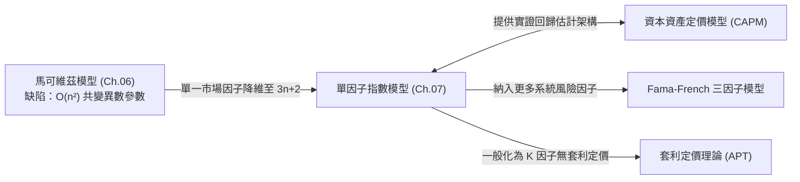

# 單因子指數模型 (Single-Index Model)

## 核心直覺

為了解決 [[markowitz-portfolio-theory|馬可維茲投資組合理論]] 在實務上需要估計 $O(n^2)$ 個共變異數參數的龐大計算與估計誤差問題，單因子指數模型 (Single-Index Model) 假設所有股票報酬的共同連動都來自**單一總體市場指數因子 ($R_M$)**，其餘波動則屬於互不相關的公司特有殘差 ($e_i$)。

此簡化不僅將待估計參數從 $O(n^2)$ 大幅降至線性規模 $3n + 2$，也將個別資產的總風險清晰拆解為系統性風險與非系統性風險兩大組成。

---

## 核心假設 (Key Assumptions)

1. **單一共同市場因子**：所有證券之間的相關性完全來自對共同市場指數超額報酬 $R_M$ 的敏感度 $\beta_i$。
2. **殘差項期望值為零且與市場獨立**：$E(e_i) = 0$，且 $\text{Cov}(R_M, e_i) = 0$。
3. **跨公司殘差項互不相關**：對任意不同兩家公司 $i \neq j$，其公司特有衝擊互不相關，即 $\text{Cov}(e_i, e_j) = 0$。

---

## 標準 LaTeX 公式與符號定義

### 1. 單因子超額報酬回歸方程式
以 [[risk-and-risk-premium|超額報酬 (Excess Return)]] $R_i = r_i - r_f$ 與市場超額報酬 $R_M = r_M - r_f$ 表示：

$$
R_i = \alpha_i + \beta_i R_M + e_i
$$

### 2. 總風險拆解方程式
對兩邊取變異數（利用 $\text{Cov}(R_M, e_i) = 0$），可得個別資產總變異數的精確分解：

$$
\sigma_i^2 = \underbrace{\beta_i^2 \sigma_M^2}_{\text{系統性風險}} + \underbrace{\sigma^2(e_i)}_{\text{公司特有（非系統性）風險}}
$$

### 3. 參數估計量大幅縮減
在 $n$ 檔股票下，只需估計以下 $3n + 2$ 個參數（遠低於 Markowitz 的 $\frac{n^2 + 3n}{2}$）：

$$
\text{Total Parameters} = \underbrace{n}_{\alpha_i} + \underbrace{n}_{\beta_i} + \underbrace{n}_{\sigma^2(e_i)} + \underbrace{1}_{E(R_M)} + \underbrace{1}_{\sigma_M^2} = 3n + 2
$$

| 符號 | 經濟意義 |
| :--- | :--- |
| $R_i = r_i - r_f$ | 資產 $i$ 之超額報酬率 |
| $R_M = r_M - r_f$ | 市場指數之超額報酬率 |
| $\alpha_i$ | 資產 $i$ 在市場超額報酬為零時的預期超額報酬（回歸截距，對應 [[beta-and-alpha\|Jensen's Alpha]]） |
| $\beta_i$ | 資產 $i$ 對市場指數變動的敏感度（回歸斜率，對應 [[beta-and-alpha\|Beta 係數]]） |
| $e_i$ | 公司特有殘差項（隨機干擾，代表非系統性衝擊） |
| $\sigma^2(e_i)$ | 公司特有風險之變異數 |

---

## 模型缺陷與限制 (Limitations & Critiques)

1. **殘差項獨立假設過於簡化**：實務上同產業公司（如兩家半導體大廠或兩家航空公司）常受到共同的產業衝擊，導致 $\text{Cov}(e_i, e_j) \neq 0$，單一市場因子無法捕捉產業或風格層級的共變性。
2. **無法解釋多維度系統風險因子**：將所有系統性風險壓縮為單一市場指數 $R_M$，忽略了規模、價值、利率或通膨等其他系統性驅動因子。
3. **屬統計估計架構而非完整均衡理論**：指數模型本身是一種簡化的報酬生成模型，並未自動保證均衡下 $\alpha_i = 0$（$\alpha_i = 0$ 是 [[capm|CAPM]] 的均衡推論）。

---

## 模型演進鏈 (Model Evolution)

- **理論前身 / 基礎**：
  - [[markowitz-portfolio-theory|馬可維茲投資組合理論]]（本模型直接克服其 $O(n^2)$ 估計瓶頸）
  - [[systematic-vs-unsystematic-risk|系統性風險與非系統性風險]]（將文字分類轉化為 $\sigma_i^2 = \beta_i^2 \sigma_M^2 + \sigma^2(e_i)$ 的定量公式）
- **後續修正 / 延伸模型**：
  - [[capm|資本資產定價模型 (CAPM)]]：在市場均衡下施加 $\alpha_i = 0$ 的理論約束，使指數模型成為估計 CAPM 參數（$\beta_i$、$\alpha_i$）的標準工具。
  - [[fama-french-three-factor|Fama-French 三因子模型]]：放寬「單一因子」限制，擴充納入 SMB 與 HML 兩大實證風格因子。
  - [[apt|套利定價理論 (APT)]]：將單因子線性生成架構推廣至一般化多因子模型並結合無套利定價。
- **所屬章節**：[[ch07-capm-and-apt|Ch.07 CAPM 與多因子定價理論]]
